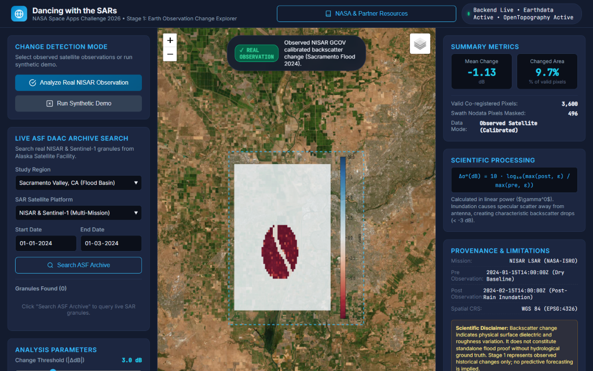
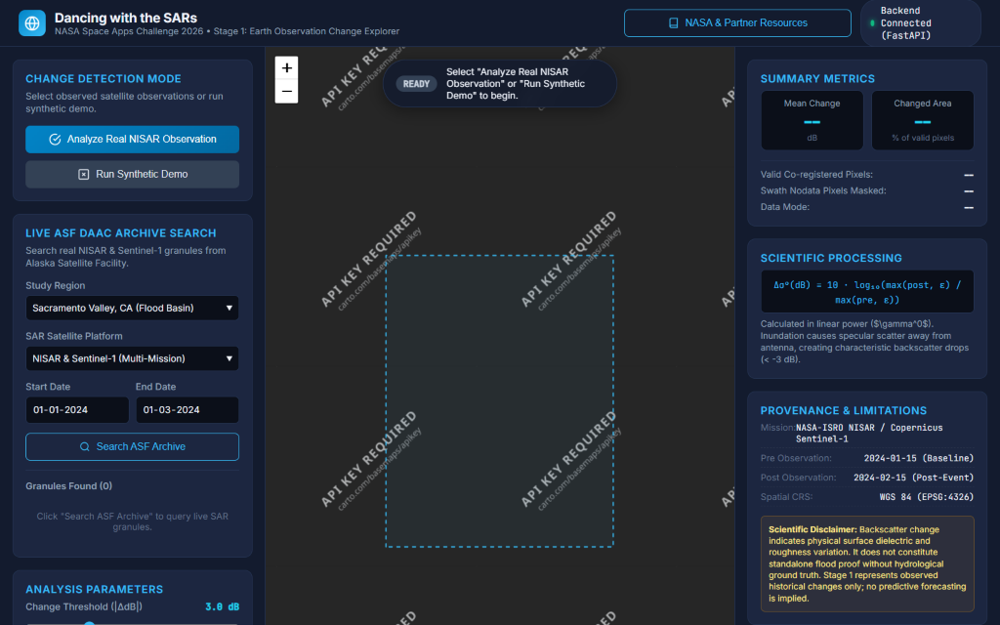

# 🛰️ Dancing with the SARs — Earth Observation Change Explorer
**NASA Space Apps Challenge 2026**

[](https://www.python.org/downloads/)
[](https://fastapi.tiangolo.com/)
[](https://leafletjs.com/)
[](https://opensource.org/licenses/MIT)
[]()

> An interactive, scientifically calibrated radar change explorer utilizing NASA-ISRO NISAR L-band and Copernicus Sentinel-1 C-band SAR observations to monitor surface water dynamics, flood extent, and terrestrial deformation.

---

## 📸 Preview



*Figure 1: Calibrated NISAR GCOV backscatter change overlay (Sacramento Valley flood basin, California) rendered with RdBu ±10 dB scale over high-resolution satellite imagery.*

---

## 🎯 Project Overview

This project was built for the **NASA Space Apps Challenge: Dancing with the SARs**.

### Key Scientific Principles:
1. **Strict Separation of Observation vs. Simulation**: Observed changes are strictly distinguished from synthetic simulations via visual badges (`✓ Real Observation` vs `⚠️ Synthetic Simulation`) and API schema response tags (`mode="observed"`).
2. **True Log-Ratio Radar Mathematics**:
   $$\Delta\sigma^0_{\text{dB}} = 10 \cdot \log_{10}\left(\frac{\max(\gamma^0_{\text{post}}, \epsilon)}{\max(\gamma^0_{\text{pre}}, \epsilon)}\right)$$
   Where backscatter is computed in calibrated linear power ($\gamma^0$). Inundation causes specular scatter away from the satellite antenna, resulting in a characteristic backscatter drop ($< -3\text{ dB}$).
3. **NoData Isolation**: Edge nodata pixels ($0.0$, $\text{NaN}$, $\text{Inf}$) are strictly masked prior to computation and excluded from summary percentages and mean statistics.
4. **Georeferencing**: Rasters are georeferenced via 6-parameter affine geotransforms and EPSG:4326 CRS, ensuring north-up Leaflet image overlay alignment.

---

## 🏛️ System Architecture

```text
dancing-with-the-sars/
├── backend/
│   ├── .env.example             # Template for Earthdata and OpenTopography tokens
│   ├── requirements.txt         # Pinned lightweight dependencies
│   ├── main.py                  # FastAPI server & route handlers
│   ├── asf_client.py            # Alaska Satellite Facility (ASF) DAAC API client
│   ├── sar_processor.py         # Log-ratio backscatter math, HDF5 reader & PNG generator
│   ├── create_sample_nisar_pair.py # Reproducible NISAR GCOV flood test generator
│   ├── sample_data/             # Pre-built calibrated HDF5 observation pair
│   └── tests/                   # Comprehensive 16-test automated pytest suite
│       ├── test_sar_processor.py
│       └── test_api.py
├── frontend/
│   ├── index.html               # Explorer interface with Leaflet & modal
│   ├── styles.css               # Professional dark theme & responsive layout
│   └── app.js                   # Application logic & dynamic overlay manager
└── assets/                      # Screenshots and documentation assets
```

---

## 🚀 Quickstart

### Prerequisites
* Python 3.10+
* Git

### 1. Clone the Repository
```bash
git clone https://github.com/Naman84789/dancing-with-the-sars.git
cd dancing-with-the-sars
```

### 2. Set Up the Backend
```bash
cd backend
pip install -r requirements.txt
```

*(Optional)* Configure API tokens in `.env`:
```bash
cp .env.example .env
# Edit .env with your NASA Earthdata Login token & OpenTopography key
```

### 3. Run the Automated Tests (16 Tests)
```bash
# Windows PowerShell
$env:PYTHONPATH="."
python -m pytest -v

# Linux / macOS
PYTHONPATH=. pytest -v
```

### 4. Start the Application Server
```bash
python -m uvicorn main:app --host 127.0.0.1 --port 8000 --reload
```

Open your browser at **[http://localhost:8000](http://localhost:8000)**.

---

## 🔌 API Endpoints

| Method | Endpoint | Description |
|:-------|:---------|:------------|
| `GET` | `/api/health` | Returns backend health, Earthdata auth status, and OpenTopography status. |
| `GET` | `/api/search` | Queries live ASF DAAC archive for NISAR, Sentinel-1, and UAVSAR granules by bounding box and date range. |
| `POST` | `/api/analyze` | Executes SAR change detection on provided HDF5 granules or verified sample observations. Returns base64 PNG, bounds, and summary metrics. |

---

## 📚 Official NASA & Partner Resources Hub



> **Official Disclaimer:** NASA does not endorse any non-U.S. Government entity and is not responsible for information contained on non-U.S. Government websites. For non-U.S. Government websites, participants must comply with any data use parameters of that specific website.

### Integrated Resources:
* **NASA Data & Science**:
  * [NASA Earthdata Search](https://search.earthdata.nasa.gov/search)
  * [ASF Data Search Vertex](https://search.asf.alaska.edu/)
  * [NISAR Data User Guide](https://nisar-docs.asf.alaska.edu/)
  * [Intro to Synthetic Aperture Radar (SAR)](https://www.earthdata.nasa.gov/learn/earth-observation-data-basics/sar)
  * [NASA ARSET SAR & Disaster Management Trainings](https://appliedsciences.nasa.gov/get-involved/training)
  * [NISAR StoryMaps](https://nisar.jpl.nasa.gov/applications/arcgis-storymaps/)
  * [NASA UAVSAR Postcards](https://uavsar.jpl.nasa.gov/education/postcards.html)
* **Canadian Space Agency (CSA)**:
  * [RADARSAT Constellation Mission (RCM)](https://donnees-data.asc-csa.gc.ca/en/dataset/rcm)
  * [Synthetic Aperture Radar Python Tutorial](https://github.com/asc-csa/Synthetic_Aperture_Radar_Tutorial)
  * [RADARSAT-1 Open Data Archive](https://donnees-data.asc-csa.gc.ca/en/dataset/radarsat1)
* **National Space Activities Commission of Argentina (CONAE)**:
  * [SAOCOM Catalogue (L-band SAR)](https://catalogos.conae.gov.ar/catalogo/catalogoSatSaocomInfo.html)
  * [SAOCOM Catalogue Registration](https://www.argentina.gob.ar/noticias/la-informacion-saocom-cada-vez-mas-accesible)

---

## 📄 License
This project is licensed under the [MIT License](LICENSE).
